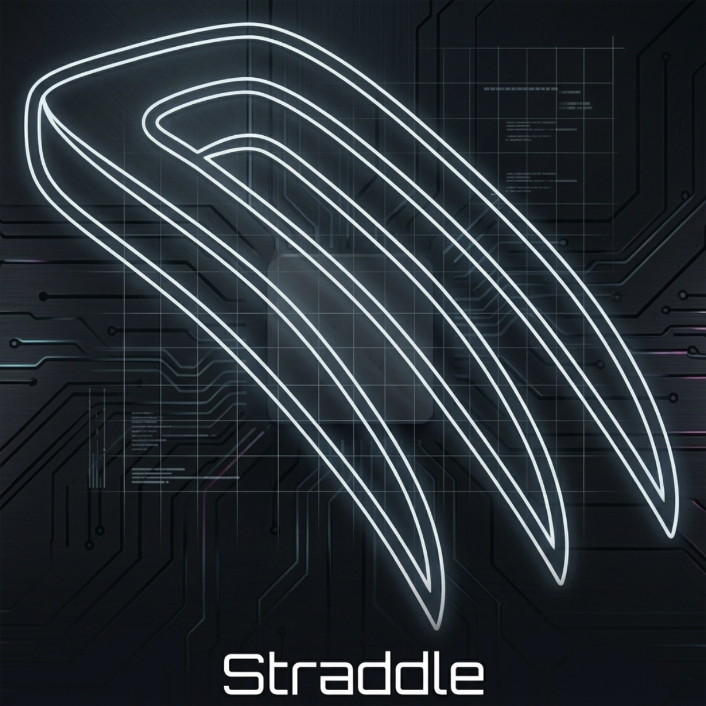
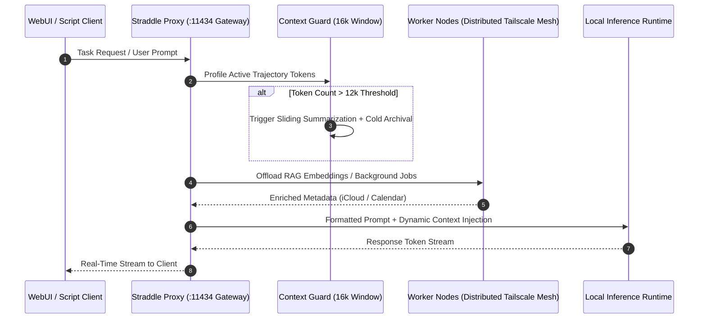

# Straddle: Autonomous Infrastructure Layer for Hermes Agent

> [!NOTE]
> **Status: Historical Precedent / Architectural Case Study**  
> Straddle was designed and implemented **prior to Hermes Agent's native plugin architecture**. Core capabilities originally prototyped here—specifically autonomous Kanban task dispatching and 16k context window compression—have since been integrated directly into upstream [Hermes Agent](https://github.com/NousResearch/hermes-agent) via native plugins (`plugins/kanban`, `plugins/context_engine`).
>
> This repository is preserved as an architectural case study in extending autonomous agent runtimes, featuring formal [Architectural Decision Records (ADRs)](docs/adr/).



---

## Pre-Plugin Architecture & Data Flow



---

## Engineering Highlights & Prior Art

1. **Sliding-Window Context Guard**:
   - Engineered hybrid compression logic (Sliding Summarize + Ephemeral Archival) to prevent context explosion on 16k token models without losing task grounding.
2. **Distributed Workload Offloading**:
   - Dispatched RAG embedding computations over a Tailscale private mesh to secondary edge nodes (e.g., Lenovo IdeaPad), preserving VRAM on primary GPU workstations (Tower).
3. **Formal Architectural Decision Records (ADRs)**:
   - Contains formal engineering trade-off documentation: See [ADR-0001: Sent Folder Check for Reply Detection](docs/adr/0001-sent-folder-check-for-reply-detection.md) detailing latency vs. consistency constraints in asynchronous email dispatch.
4. **Unified Gateway Middleware**:
   - Consolidated fragmented client configurations (Open WebUI, CLI tools, automation scripts) into a single upstream Ollama proxy with centralized prompt management.

---

## Legacy Installation

```bash
curl -fsSL https://raw.githubusercontent.com/thomas-m-brown/straddle/main/install.sh | bash
```

### Stack & Dependencies
- Python 3.10+
- Node.js (WebUI injection)
- Tailscale (Mesh worker offloading)
- Ollama inference backend

---

## License

MIT
